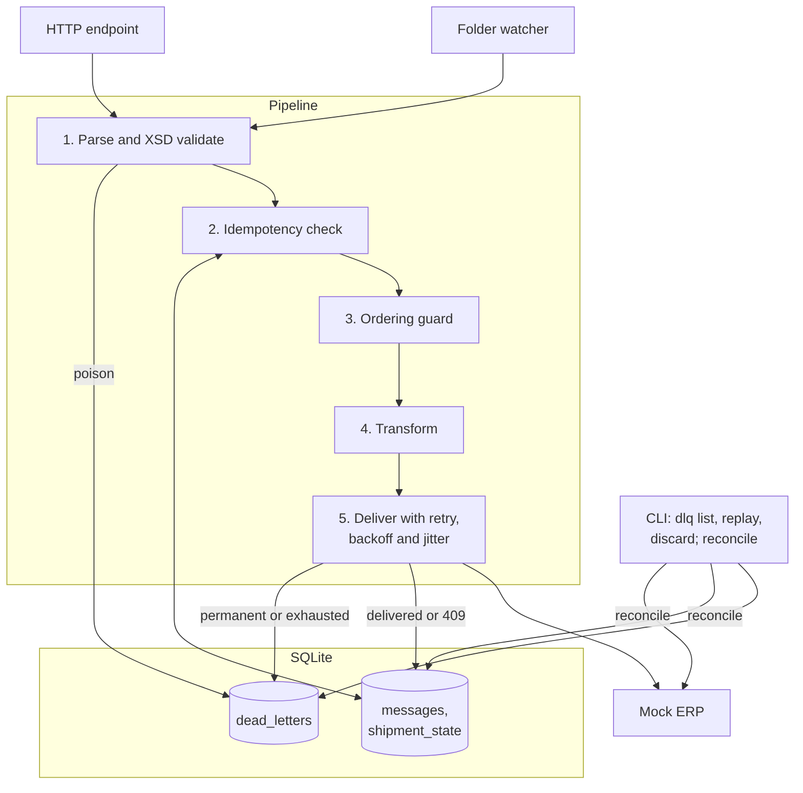

# cargowise-integration-patterns

[](https://github.com/pJijesh/cargowise-integration-patterns/actions/workflows/ci.yml) [](LICENSE)  

**Problem:** moving shipment messages into an ERP reliably is harder than it looks, because networks lose acknowledgements, senders resend, updates arrive out of order, and bad data must be corrected without losing anything.

**For:** hiring managers, architects and engineers in logistics and ERP integration who want to see how these problems are reasoned about and handled.

**Demonstrates:** idempotent, observable and recoverable message delivery, shown with working Python (standard library only), tests, architecture decision records, a runbook and a neutral build-versus-buy guide.

> **Independent and unofficial.** This repository is not affiliated with, endorsed by or sponsored by WiseTech Global. CargoWise is a trademark of its owner. **No real schemas, credentials, customer data or proprietary documentation are included.** Every message shape here, including the XSD, is *illustrative* and deliberately simplified. It is not the Universal Shipment schema or any other real CargoWise format, and the code is not a CargoWise connector. The ERP in the demo is a mock.



## What is in it

* **A reference implementation** (`src/mini_middleware/`): folder and HTTP inbound adapters, XSD validation, a transformer, an idempotency store (SQLite), delivery to a mock ERP, retry with exponential backoff and jitter, a dead-letter store with list and replay commands, structured JSON logs with correlation ids, and a reconciliation report.
* **A scripted demo** that shows success, retries, a lost acknowledgement, poison messages, an outage that ends in the dead-letter queue, a replay, a duplicate, a stale update and reconciliation. Its real output is in [`docs/demo-output.md`](docs/demo-output.md).
* **Tests** (pytest): unit tests plus integration tests that run the real pipeline against the mock ERP over HTTP.
* **Documents**: architecture with diagrams, a patterns catalogue, a failure-modes runbook, eight ADRs and a build-versus-buy guide.

## Quick start

Requires Python 3.11 or newer. The runtime needs nothing beyond the standard library.

```bash
git clone https://github.com/pJijesh/cargowise-integration-patterns.git
cd cargowise-integration-patterns

make demo          # scripted end-to-end demonstration (a few seconds)
make test          # needs pytest; install lxml as well to enable the XSD cross-check
```

Without `make`:

```bash
PYTHONPATH=src python3 -m mini_middleware demo
pip install pytest lxml && python3 -m pytest -q
```

Try the pieces by hand, with a mock ERP in one terminal and the middleware in another:

```bash
# terminal 1
export MM_ERP_TOKEN=dev-token
PYTHONPATH=src python3 -m mini_middleware mock-erp --port 8099

# terminal 2
export PYTHONPATH=src MM_ERP_TOKEN=dev-token MM_DB_PATH=./data/mm.db
python3 -m mini_middleware ingest examples/valid-shipment.xml examples/invalid-shipment.xml
python3 -m mini_middleware dlq list
sed 's/TELEPORT/SEA/' examples/invalid-shipment.xml > /tmp/fixed.xml
python3 -m mini_middleware dlq replay 1 --payload-file /tmp/fixed.xml
python3 -m mini_middleware reconcile              # exit 0 when clean, 2 when not
```

Other commands: `watch --dir DIR [--once]` (folder drop), `serve --port 8080` (HTTP endpoint), `dlq show|replay-all|discard`. Configuration is by `MM_*` environment variables; see `src/mini_middleware/config.py`.

## Repository map

```text
.
├── README.md, LICENSE, CONTRIBUTING.md, Makefile, pyproject.toml
├── .github/workflows/ci.yml          tests on Python 3.11, 3.12, 3.13 plus a demo smoke run
├── examples/                         one valid and one invalid illustrative message
├── src/mini_middleware/
│   ├── config.py                     environment-based configuration
│   ├── adapters/                     folder.py (file drop), http_inbound.py (HTTP endpoint)
│   ├── schemas/shipment_message.xsd  the illustrative schema
│   ├── xsd.py, validation.py         XSD-subset validator, parse and validate
│   ├── transformer.py                canonical model, ERP-side mapping, fingerprint
│   ├── idempotency.py, db.py         SQLite idempotency store, sequence guard
│   ├── delivery.py, retry.py         ERP client, error taxonomy, backoff with jitter
│   ├── ratelimit.py                  token bucket
│   ├── dlq.py                        dead-letter store
│   ├── pipeline.py                   the orchestration
│   ├── reconcile.py                  reconciliation report
│   ├── logging_setup.py, metrics.py  JSON logs, correlation ids, counters
│   ├── mock_erp.py                   mock ERP that simulates 201, 409, 422, 429, 500, 503, timeout
│   ├── cli.py, demo.py, samples.py   command line, demo script, message builders
├── tests/                            unit and integration tests
└── docs/
    ├── architecture.md               context, container, sequence and lifecycle diagrams
    ├── patterns-catalogue.md         the patterns, with trade-offs and where each lives in the code
    ├── failure-modes-runbook.md      failure modes and operator procedures
    ├── build-vs-buy.md               neutral decision guide
    ├── adr/                          eight decision records (MADR format)
    ├── diagrams/                     Mermaid sources and rendered PNGs
    └── demo-output.md                real output of `make demo`
```

## Patterns at a glance

| Pattern | Where to look |
|---|---|
| Transport options: file drop, HTTP, queue | [catalogue](docs/patterns-catalogue.md#transport), [ADR 0001](docs/adr/0001-direct-http-delivery-versus-queue.md) |
| Idempotency, deduplication keys | [ADR 0002](docs/adr/0002-idempotency-strategy.md), `idempotency.py` |
| Retry, backoff, jitter, dead-letter, poison messages | [ADR 0003](docs/adr/0003-error-classification-and-retry.md), `retry.py`, `dlq.py` |
| Schema validation and versioning | [ADR 0004](docs/adr/0004-schema-validation-and-versioning.md), `xsd.py` |
| Ordering | [ADR 0006](docs/adr/0006-ordering-strategy.md) |
| Observability, security | [catalogue](docs/patterns-catalogue.md#observability), [ADR 0007](docs/adr/0007-correlation-ids-and-structured-logging.md) |
| Reconciliation | [ADR 0008](docs/adr/0008-reconciliation-as-a-detective-control.md), `reconcile.py` |
| Operating it when it goes wrong | [runbook](docs/failure-modes-runbook.md) |

## Limitations

This is a teaching reference, and it says so plainly.

* **Not a CargoWise connector and not production software.** It has not been used to run a real workload, and no performance, throughput or reliability claims are made.
* **Illustrative formats only.** The inbound message, the ERP-side message and the HTTP conventions (`Idempotency-Key`, `409` for duplicates) are invented for this repository. A real ERP interface will differ in format, authentication, batching, acknowledgement semantics and error codes.
* **The XSD validator covers a subset of XSD 1.0**, enough for the illustrative schema. A test cross-checks it against lxml on a set of cases, which is evidence, not proof. Use a complete engine for real schemas.
* **Intake is synchronous.** The HTTP adapter replies only after delivery attempts finish. A production design would persist first and acknowledge with `202` ([ADR 0001](docs/adr/0001-direct-http-delivery-versus-queue.md)).
* **SQLite, single host.** No high availability, and no multi-host scaling ([ADR 0005](docs/adr/0005-sqlite-as-state-store.md)). Marking a message dead and writing its dead-letter row are two separate transactions.
* **Ordering is a sequence guard, not strict FIFO.** Gaps in sequence numbers are not detected ([ADR 0006](docs/adr/0006-ordering-strategy.md)).
* **No circuit breaker, no retention policy for old idempotency keys, no TLS, no real secrets management.** Secrets come from environment variables. Alert thresholds in the docs are suggestions and were not tested against a real monitoring stack.
* **No container files.** A Dockerfile was not included because it could not be built and verified when this repository was prepared.
* **Not independently reviewed.** Treat it as one person's reasoning, to be challenged.

## Roadmap

Planned, not promised. Order and timing change with other work.

- **Next:** Add circuit breaker pattern; Add webhook signature verification pattern
- **Then:** Add structured logging and metrics example; Add contract test example
- **Later:** Add schema versioning pattern; Release v1.1

## About the author

Jijesh Puliyappottammal is an IT Manager working in freight and logistics technology, with a background in ERP integration, cloud infrastructure and IT governance. GitHub: [pJijesh](https://github.com/pJijesh). LinkedIn: [linkedin.com/in/pjijesh](https://www.linkedin.com/in/pjijesh).

The views and designs here are the author's own, written from general engineering knowledge and public information, and do not describe any employer's or client's systems.

## Licence

MIT. See [LICENSE](LICENSE). Contributions are welcome under the guidelines in [CONTRIBUTING.md](CONTRIBUTING.md).
