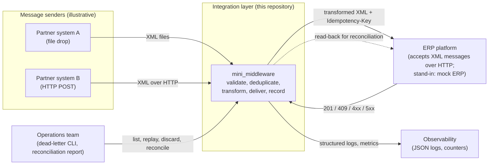
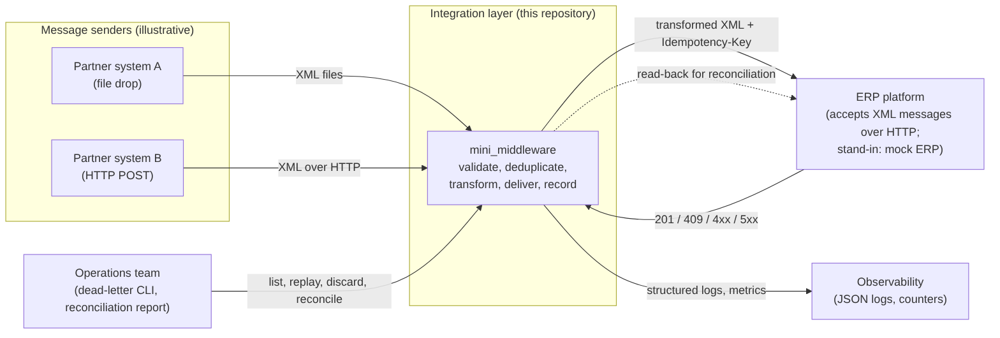
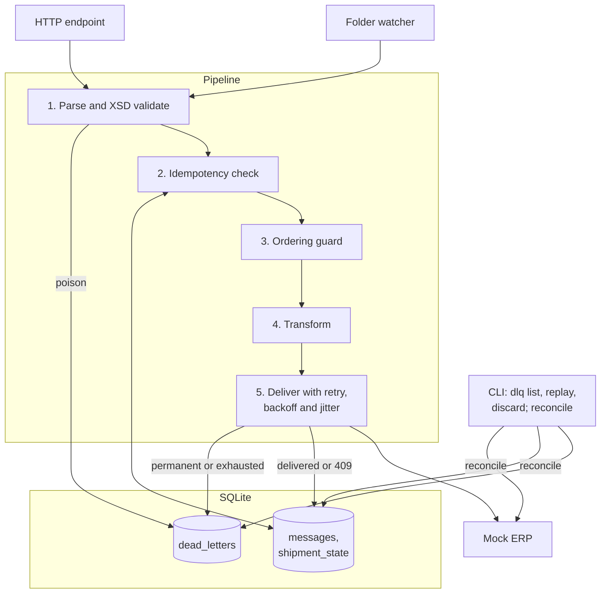
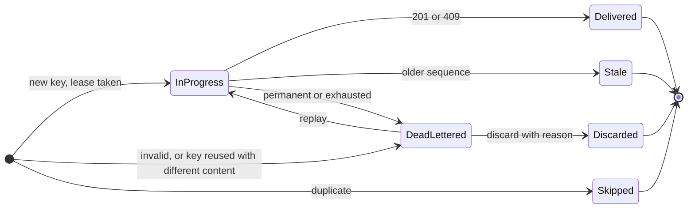
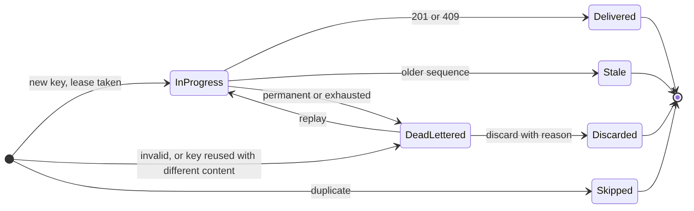
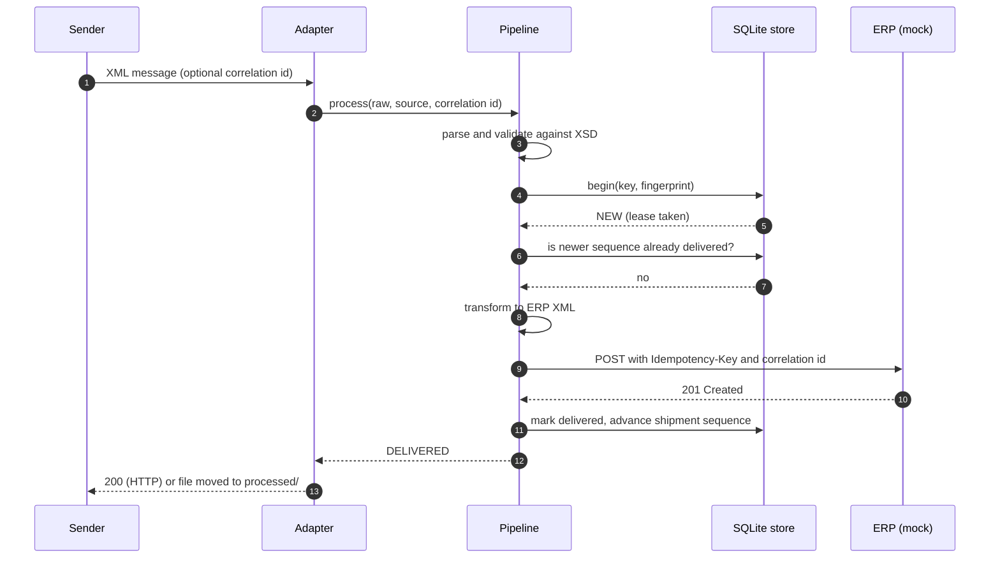
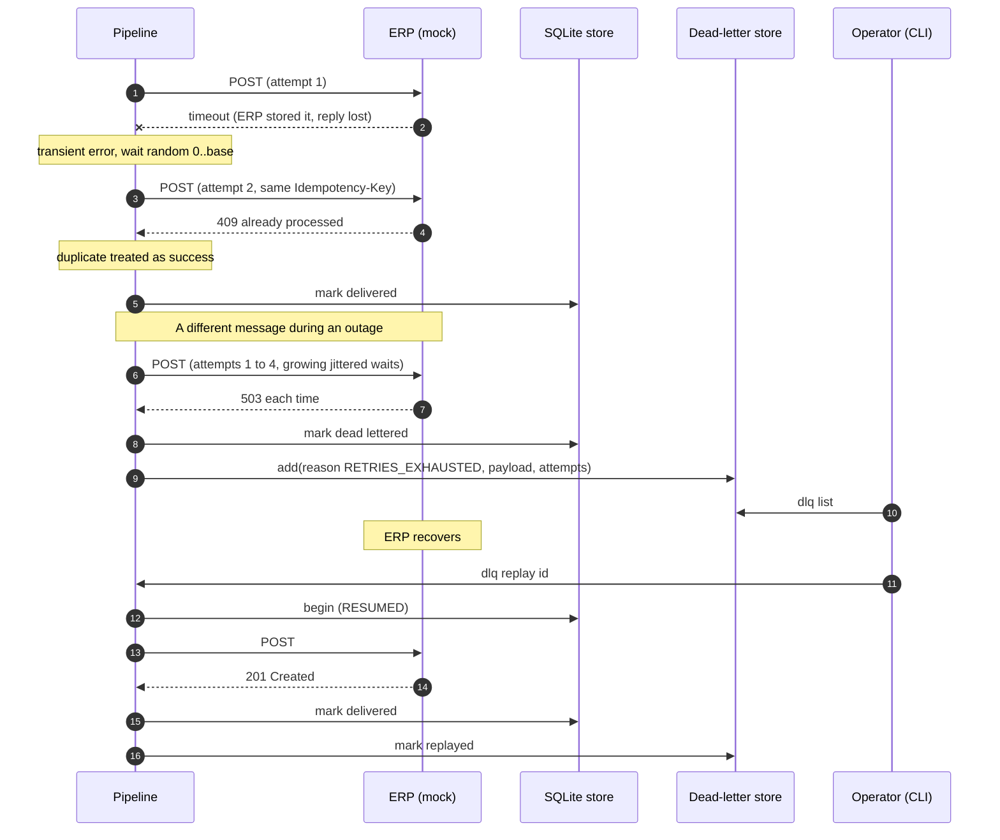

# Architecture overview and reference architecture

> Independent, unofficial reference. Not affiliated with or endorsed by WiseTech Global. CargoWise is a trademark of its owner. No real schemas, credentials, customer data or proprietary documentation are included. All message shapes here are illustrative and simplified.

## 1. Purpose and scope

This document describes a small integration layer ("middleware") that sits between systems that send shipment status messages and an ERP that receives them. The implementation in `src/mini_middleware/` is deliberately small enough to read in an afternoon, yet it exercises the problems that decide whether an integration is dependable in practice: duplicates, partial failures, out-of-order delivery, malformed input, downstream outages and the need to explain afterwards what happened to any given message.

What it is:

* a worked example of integration patterns, written with the Python standard library only
* a vehicle for discussing trade-offs (see the ADRs and the build-versus-buy guide)

What it is not:

* a CargoWise connector. It does not use, reproduce or approximate any real CargoWise schema, endpoint or authentication scheme.
* a production system. See the limitations in the [README](../README.md#limitations).

## 2. Public context

ERP integration in freight forwarding commonly involves exchanging XML messages with the ERP over a messaging interface (for CargoWise One, WiseTech's public material and third-party partner documentation describe this as the eAdaptor). Public third-party descriptions mention XML payloads that may be wrapped, compressed and batched, sent in the order they were generated, with order mattering to the receiver. Treat that as orientation only. Anyone building a real integration should work from the official documentation that their licence entitles them to, which this repository neither contains nor replaces.

The patterns below do not depend on those details. They apply to any ERP that accepts messages asynchronously and may fail, time out or receive the same message twice.

## 3. System context

Rendered copies of every diagram are kept in [`docs/diagrams/`](diagrams/) as PNG files for viewers that do not render Mermaid.

## 4. Containers and components

| Component | Module | Responsibility |
|---|---|---|
| Folder watcher | `adapters/folder.py` | Poll `inbox/`, claim files by atomic rename, move to `processed/` or `failed/` |
| HTTP endpoint | `adapters/http_inbound.py` | `POST /messages`, bearer-token check, size limit, correlation id intake, `/healthz`, `/metrics` |
| Validation | `validation.py`, `xsd.py`, `schemas/*.xsd` | Reject malformed XML and anything that fails the illustrative XSD |
| Transformer | `transformer.py` | Parse to a canonical model, normalise units, map to the ERP-side shape |
| Idempotency store | `idempotency.py`, `db.py` | Claim a key with a lease, detect duplicates, key reuse and stale updates |
| Delivery client | `delivery.py`, `ratelimit.py` | HTTP POST with timeout, no redirects, transient or permanent classification |
| Retry policy | `retry.py` | Exponential backoff with full jitter, honours `Retry-After` |
| Dead-letter store | `dlq.py` | Hold failed messages with a reason code, support replay and discard |
| Reconciliation | `reconcile.py` | Compare local delivery records with what the ERP reports holding |
| Observability | `logging_setup.py`, `metrics.py` | JSON logs with correlation ids, redaction, counters |
| Mock ERP | `mock_erp.py` | Deterministic misbehaviour for tests and the demo |
| CLI | `cli.py` | `ingest`, `watch`, `serve`, `dlq ...`, `reconcile`, `demo` |

## 5. Message lifecycle

Every message ends in exactly one terminal state, and the state is recorded.

Transient failures keep a message in `InProgress` while it is retried. If a worker dies mid-flight, its lease expires and the next delivery of the same message resumes it. Neither of those loops is drawn, to keep the picture readable.

## 6. Sequences

### 6.1 Happy path

### 6.2 Failure path: lost acknowledgement, outage, dead letter and replay

The first half of this diagram is the subtle case. The ERP stored the message but the reply was lost, so the sender sees a timeout and retries. Because the retry carries the same `Idempotency-Key`, the ERP answers `409`, and the middleware treats that as success. Without a stable key, the same retry would create a second record.

## 7. Data model

Three SQLite tables, created by `db.py`:

| Table | Purpose | Key columns |
|---|---|---|
| `messages` | One row per idempotency key | `idempotency_key` (primary key), `fingerprint`, `status` (`IN_PROGRESS`, `DELIVERED`, `DEAD_LETTERED`, `STALE`), `attempts`, `lease_expires`, `correlation_id`, `last_error` |
| `shipment_state` | Highest delivered sequence per shipment reference | `reference`, `last_sequence` |
| `dead_letters` | Messages needing a human decision | `id`, `reason`, `detail`, `attempts`, `payload`, `status` (`DEAD`, `REPLAYED`, `DISCARDED`), `replay_count`, `resolution` |

## 8. Design principles

1. **Assume every message arrives more than once.** Safety comes from idempotency, not from hoping the network behaves.
2. **Separate "try again" from "give up".** Transient failures are retried. Permanent failures and exhausted retries go to the dead-letter store with a reason code. Nothing is silently dropped.
3. **Validate at the boundary.** Bad input is rejected before it can touch the ERP, and kept so someone can fix and replay it.
4. **Every decision leaves a record.** A correlation id follows a message through logs, the idempotency table and the dead-letter store.
5. **Trust, but verify.** Reconciliation is a detective control that finds what the other controls missed.
6. **Keep humans in the loop for judgement calls.** Replay and discard are explicit operator actions with an audit trail (`resolution`, `replay_count`).

## 9. From reference to real deployment

The reference implementation makes simplifications on purpose. A real deployment would typically change the following, and the ADRs explain the reasoning:

| Reference implementation | Typical real-world choice | ADR |
|---|---|---|
| Synchronous processing inside the HTTP request | Persist first, acknowledge with `202`, process on workers | [0001](adr/0001-direct-http-delivery-versus-queue.md) |
| SQLite on local disk | A managed relational database, or a broker with native dead-lettering | [0005](adr/0005-sqlite-as-state-store.md) |
| Environment-variable secrets | A secrets manager with rotation | [patterns catalogue](patterns-catalogue.md#security) |
| In-process counters | A metrics backend with alert rules | [patterns catalogue](patterns-catalogue.md#observability) |
| Subset XSD validator | A full XSD engine, if the real schemas need one | [0004](adr/0004-schema-validation-and-versioning.md) |
| Single process | Several workers, which the lease design already allows for | [0002](adr/0002-idempotency-strategy.md) |
